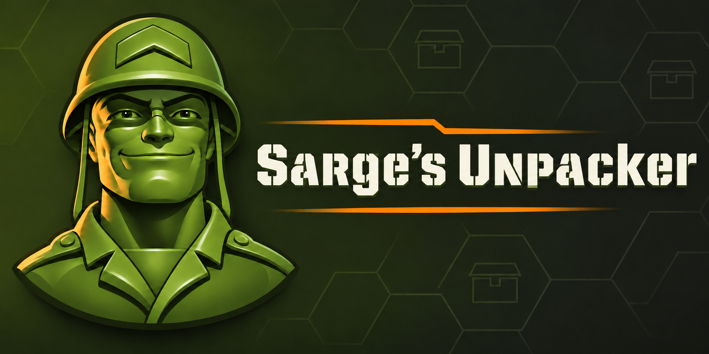

<p align="center">
  
</p>

Sarges Unpacker is a Rust command-line tool for reading and writing the NORK
archive files used by *Army Men RTS*. It provides create, extract, list,
validate, and statistics operations for `.x` archives.

## Historical reference

The original utility identifies itself as **Doctor Pack** and contains the
build timestamp **February 4, 2000**. The original binary does not
identify an individual author or organization, so this project makes no
authorship attribution.

## Features

- Create NORK v1 archives from files.
- Extract archive members while preserving their stored relative paths.
- Extract all `.x` archives found in a directory into separate output directories.
- List archive members with names, sizes, and payload offsets.
- Validate archive structure with `verify`.
- Report archive statistics with `stats`.
- Produce JSON for list, validation, and statistics output.
- Recursively include subdirectories during creation.
- Filter files with case-insensitive `*` and `?` masks.
- Perform dry runs without creating or modifying output files.
- Choose refuse, overwrite, or skip behavior for existing extraction files.
- Emit optional per-member progress messages.
- Reject unsafe extraction paths and malformed archive metadata.

## Requirements

- Rust and Cargo with edition 2021 support.
- An existing Army Men RTS installation is only required for testing against
  the game's archives; it is not required to build the tool.

## Build

Build a debug executable with:

```text
cargo build
```

Build an optimized executable with:

```text
cargo build --release
```

The release executable is written to `target/release/`.

## Usage

The command-line syntax is:

```text
sarges-unpacker <command> [options] <archive> [directory]
```

### Create

Create an archive from the current directory:

```text
sarges-unpacker create output.x
```

Create an archive from a specified directory and include subdirectories:

```text
sarges-unpacker create -r output.x path/to/source
```

Apply a file-name mask while creating an archive:

```text
sarges-unpacker create -r -m=*.cfg output.x path/to/source
```

Creation stores member paths relative to the source directory. Without `-r`,
only files directly inside the source directory are considered.

### Extract

Extract an archive into the current directory:

```text
sarges-unpacker extract archive.x
```

Extract into a specific directory:

```text
sarges-unpacker extract archive.x path/to/destination
```

Extraction preserves the relative member paths stored in the archive. Absolute
paths and paths containing parent-directory components are rejected.

### List

List archive members:

```text
sarges-unpacker list archive.x
```

### Extract all

Extract every archive directly inside a directory. Each archive is extracted
into a directory named after its file stem:

```text
sarges-unpacker extract-all path/to/archives path/to/output
```

Use `--recursive` to discover archives in nested directories. The directory
path relative to the input root is preserved, so `missions/gb/attic.x` is
extracted to `output/missions/gb/attic/`:

```text
sarges-unpacker extract-all --recursive path/to/archives path/to/output
```

By default, extraction continues after an individual archive failure and
reports the failures at the end. The command exits unsuccessfully if any
archive could not be extracted. Existing-file, dry-run, progress, quiet, and
verbose options use the same behavior as single-archive extraction.

### Verify and stats

Validate an archive:

```text
sarges-unpacker verify archive.x
```

Display archive statistics:

```text
sarges-unpacker stats archive.x
```

The `--json` option is available for `list`, `verify`, and `stats`:

```text
sarges-unpacker list --json archive.x
sarges-unpacker verify --json archive.x
sarges-unpacker stats --json archive.x
```

## Options

| Option | Purpose |
| --- | --- |
| `-r` | Include files in nested directories when creating an archive. |
| `--recursive` | Include nested directories when discovering archives with `extract-all`. |
| `-m=MASK` | Select files by a case-insensitive `*`/`?` file-name mask. |
| `--json` | Use JSON output where supported. |
| `--dry-run` | Validate or plan an operation without writing output files. |
| `--overwrite` | Replace existing files during extraction. |
| `--skip-existing` | Leave existing extraction files unchanged. |
| `--progress` | Print per-member progress messages. |
| `--quiet` | Suppress normal operation output. |
| `--verbose` | Enable verbose operation output. |
| `--version` | Print the program version. |
| `--help` | Print command usage. |

The command-line parser accepts the option forms shown above. Conflicting
existing-file policies are rejected.

## Archive format

The implementation reads and writes NORK v1 archives. Member payloads are
stored as opaque bytes; the archive directory records each member's name,
payload offset, and payload size.

For the complete documented layout, observed values, validation rules, and
known limitations, see the [NORK file-format documentation](docs/file-format.md).

## Verification

The project includes unit and integration tests for archive parsing, archive
writing, command-line parsing, traversal safety, extraction policies,
deterministic ordering, dry-run behavior, and malformed input handling.

The implementation was also compared with the original `drpack.exe` using the
installed Army Men RTS `missions/gb/attic.x` archive. That comparison produced
15 files on each side with zero missing files, extra files, or byte mismatches.

## Development checks

Run the standard local checks with:

```text
cargo fmt --check
cargo clippy --all-targets --all-features -- -D warnings
cargo test --all-targets --all-features
cargo build --release
```

## Project status

The tool supports the archive operations currently implemented and tested in
this repository. Compatibility claims are limited to the NORK behavior
observed in the analyzed Army Men RTS test archives; undocumented
variants of the format may require additional investigation.
